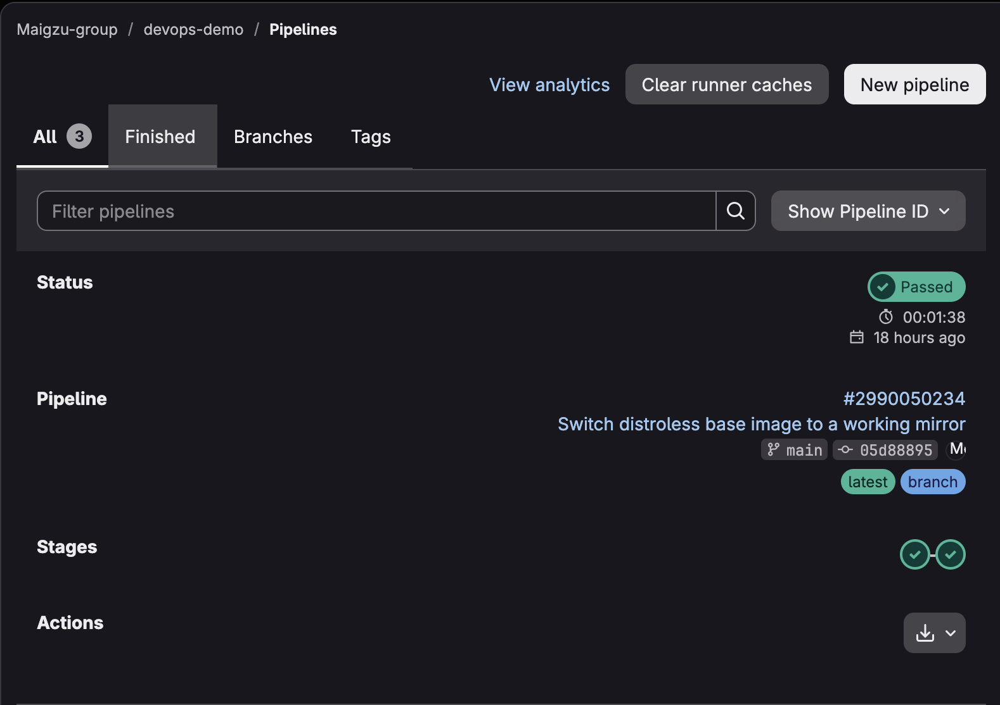
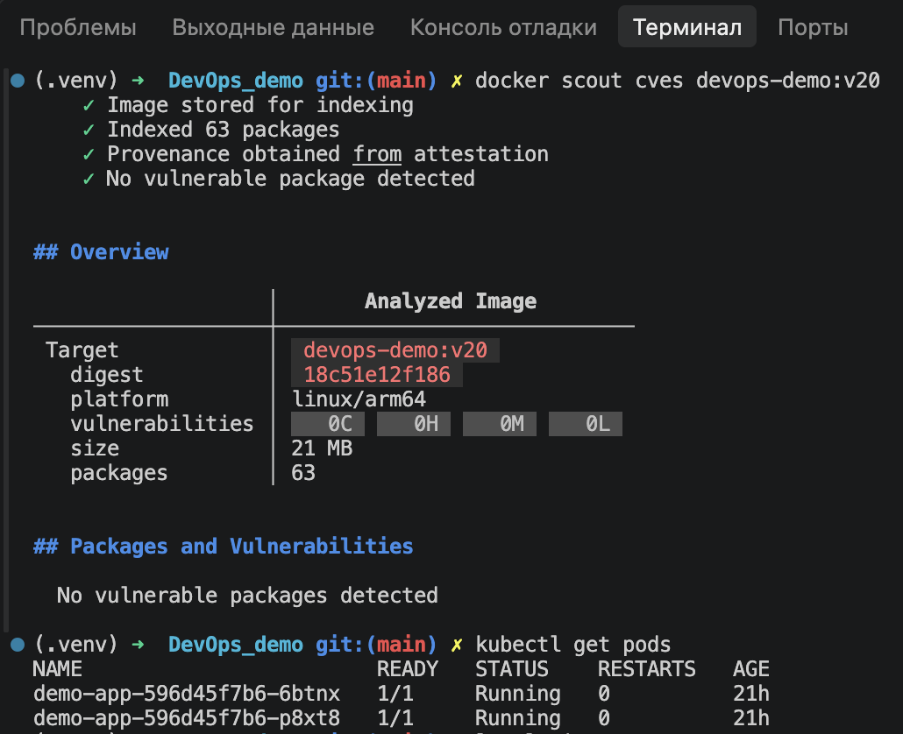

# DevOps Demo Project

Полный цикл разработки и развертывания приложения (Flask) с использованием современных DevOps-практик.

## Стек технологий:
1.   **Язык**: Python 3.11 (Flask, Gunicorn)
2.   **Контейнеризация**: Docker (Multi-stage build, Distroless image, Non-root user)
3.   **Оркестрация**: Kubernetes (Deployment, Service, Readiness/Liveness Probes)
4.   **CI/CD**: GitLab CI (Lint, Test, Build, Push to Registry)
5.   **Автоматизация**: Ansible (Idempotent deployment to K8s)

## Безопасность и оптимизация
1.   Итоговый размер Docker-образа: **~21 MB**.
2.   Количество уязвимостей (по данным `docker scout`): **0**.
3.   Приложение работает от непривилегированного пользователя (`nonroot`).

## Безопасность и оптимизация
1. Итоговый размер Docker-образа: **~21 MB**.
2. Количество уязвимостей (по данным `docker scout`): **0**.
3. Приложение работает от непривилегированного пользователя (`nonroot`).

## Скриншоты работы
**Успешный CI/CD пайплайн в GitLab:**

**Сканер безопасности и поды в Kubernetes:**

## Структура проекта
1.   `app.py`, `requirements.txt` — исходный код и зависимости.
2.   `Dockerfile` — инструкция сборки оптимизированного образа.
3.   `k8s/app.yaml` — манифесты Kubernetes.
4.   `.gitlab-ci.yml` — пайплайн CI/CD.
5.   `ansible/` — плейбуки для автоматизации деплоя.

## Как запустить локально

### Вариант 1: Через Docker
1. Собрать образ: `docker build -t devops-demo:v20 .`
2. Запустить контейнер: `docker run -p 9090:5000 devops-demo:v20`
3. Открыть в браузере: `http://localhost:9090/healthz`

### Вариант 2: Через Kubernetes (Docker Desktop)
1. Применить манифесты: `kubectl apply -f k8s/app.yaml`
2. Проверить статус подов: `kubectl get pods` (дождаться статуса `Running`)
3. Открыть в браузере: `http://localhost:30080/healthz`

### Вариант 3: Автоматизация через Ansible
1. cd ansible && ansible-playbook -i inventory.ini playbook.yml